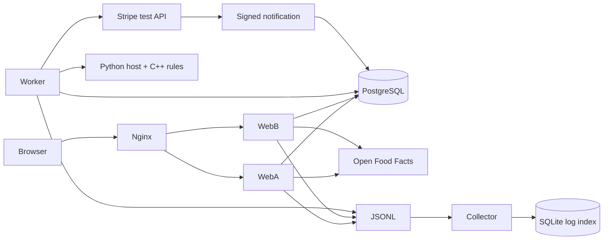
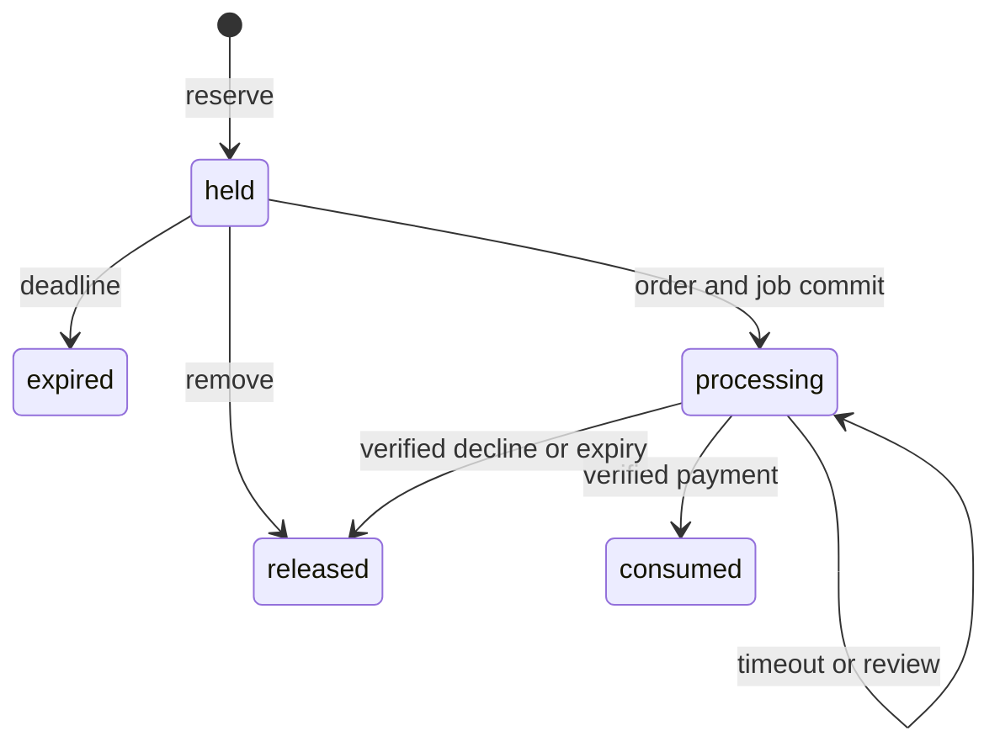

# Architecture decisions

The original first-year project mixed menus, stock changes, and CSV writes. The first refactor separated the C++ service, persistence, and logging. The browser application extends the domain to concurrent customers and stores, where one local snapshot is no longer an adequate transaction boundary.

## Modular monolith

Catalog, reservations, orders, and warehouse transfers share one Django application and PostgreSQL database. Short ACID transactions keep related changes consistent. Splitting each module into a service would introduce distributed transactions and compensation without enough independent scale to justify them.

Two web processes run the same application. The worker shares its models and services; it is another process of the monolith. The simulated payment provider is deliberately external, because real payment processing is external too.

## MVC mapping

Django calls its pattern Model–Template–View. In MVC terms, routing and view functions are controllers, templates provide presentation, and ORM models plus services implement data and rules.

| Layer | Files | Responsibility |
| --- | --- | --- |
| Controller | Views, forms, URL routes | Parse requests, validate input, resolve identity and permissions |
| Services | Order services/worker; catalog services/warehouse | Transactions, locks, authorization, state transitions |
| Model | ORM models, migrations, constraints | Relationships and persistent invariants |
| View | Templates and CSS | Escaped output and CSRF-protected forms |
| Adapters | Catalog providers and payment gateways | Translate external contracts |

The ORM provides persistence abstraction; another generic repository would duplicate it. Services repeat critical permission checks so non-HTTP callers cannot bypass store boundaries.

## Reservations and payments

Adding to a cart increases reserved stock, leaving on-hand stock unchanged. Reducing quantity releases the difference. Open-cart reservations last 15 minutes by default. The worker sweeps expiry; cart mutations also recheck under lock. Empty lines retain a released/expired state rather than disappearing.

Checkout snapshots prices and names, marks the cart processing, and inserts the order and payment job in one transaction. Ordinary expiry/removal can no longer release those reservations. A network timeout is an unknown outcome, not a decline.

The worker claims a job with a 30-second lease and calls the provider outside any transaction. A lease token rejects stale responses. Completion locks cart, job, and inventory and applies stock/ledger changes together. Repeated completion has no effect. Five consecutive call failures require review while keeping reservations protected.

PostgreSQL row locks serialize competing writes. Inventory locks use ID order; constraints and conditional updates prevent overselling. Manager forms carry an optimistic version so stale edits cannot overwrite recent reservations or sales. SQLite development uses immediate write transactions; PostgreSQL tests establish row-lock behavior.

## Audit and warehouse transfers

InventoryEvent records opening stock, reserve, release, expiry, sale, manager adjustment, and warehouse receipt in the same transaction as the change. Listings are hidden rather than deleted. Events form an HMAC chain anchored on Inventory; verification also compares the final stock projection. This is tamper evidence while the key is trusted, not an immutable external audit system.

Warehouse quantities are separate. A completed transfer subtracts warehouse stock, adds store stock, and records both movements atomically. Unique request keys make retries idempotent. Physical dispatch, transit, partial receipts, and returns are outside this model. Warehouse movement records are audited but do not yet have an HMAC chain.

## Synchronous versus asynchronous

| Action | Mode | Tradeoff |
| --- | --- | --- |
| Browse | Synchronous read | Displayed availability may change before submission |
| Reserve/release/edit/transfer | Synchronous database transaction | Definite result; competing writers briefly wait |
| Checkout creation | Synchronous database transaction | Durable order/job before acknowledgment; no network under locks |
| Provider call/reconciliation | Asynchronous worker | Pending UI; retries need leases and idempotency |
| Stripe Checkout | Hosted user interaction | Card data stays with Stripe; redirect is not payment evidence |
| Expiry | Async sweep plus sync recheck | Safe but availability can lag until the next sweep |
| Food search | Synchronous with timeout | Provider delay is visible; manual entry remains available |
| Import | Synchronous transaction | Signed reviewed snapshot; no HTTP while holding locks |
| Log collection | Async five-second poll | Best effort and delayed; distinct from the transactional stock ledger |

## Plugin boundaries and limits

OpenFoodFacts maps external data to normalized candidates. The application owns approval, deduplication, and inventory. Search is text matching, not a guarantee of equivalent substitutes.

The C++ simulator kernel evaluates registered Rule implementations. Its Python host owns HTTP, signatures, idempotency storage, and delays. Rules are compiled plugins, not dynamically loaded modules or an OS microkernel. Stripe bypasses this fake decision engine and supplies its own test-mode outcome.

The database is a single point of failure. Two web containers demonstrate application failover only. The collector rereads rotating files rather than shipping by offset. Public deployment would require HTTPS ingress, backups, secrets management, abuse controls, and customer-data retention. More services would not solve those operational requirements.
