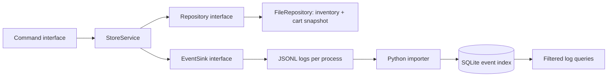

# Revisiting a first-year project

The original PRG210 project was a team-built grocery store application. It used global inventory, raw owning pointers, menu classes that also saved files, and separate CSV writes for inventory and cart state. That was the starting point for this later systems-architecture exercise.

The goal of the refactor is to make state changes easier to reason about and failures easier to investigate. It remains a small, single-process application.

## Before and after

| Original design | Refactored design | Reason |
| --- | --- | --- |
| Global inventory shared by menus | A `StoreService` owns the current state | Makes dependencies and state ownership explicit |
| Menus change stock and write CSV | CLI calls service methods; a repository handles persistence | Business rules can be tested without terminal input or files |
| Owning pointers and fixed arrays | Value types and standard containers | Automatic cleanup and safe copies for proposed changes |
| Separate inventory and cart saves | One versioned snapshot containing both | Avoids persisting one half of a reservation |
| Products matched by name | Stable integer product IDs | Identically named products remain distinct |
| Floating-point prices | Integer cents | Exact subtotals within validated bounds |
| Printed success/error messages | Structured events with operation, node, outcome, and duration | Supports filtering across application instances |
| Manual happy-path demo | Rule tests, injected save failures, restart tests, and CI | Exercises the failure paths as well as the demo |

## The transaction boundary

Adding to the cart reserves stock immediately. Removal and cancellation release the reservation; checkout clears the cart without reducing stock a second time. Exiting leaves the cart reserved and persisted for the next session. There is one shared cart per store file.

For each mutation, the service copies its current state, applies the requested operation, validates the result, saves it, and then swaps it into memory. The final swap cannot throw. A failed validation or save leaves the previous in-memory state unchanged. The repository's contract requires failed writes to preserve the previous snapshot.

The file implementation writes a temporary snapshot in the same directory and replaces the destination only after writing and closing it successfully. A lock directory prevents cooperating processes from opening the same store simultaneously. This is intended for local filesystems: it does not claim distributed locking, database isolation, or power-loss durability. There is no explicit disk synchronization. A crash can leave a stale lock that requires operator review.

This design fixes the original split-write problem without introducing a database server for four sample products. SQLite is used where queries and indexes are useful: the log collector. A future transactional SQL implementation can replace `Repository`, but it is not implemented here.

## Observability and collection

Each process writes to its own JSONL file. Events have a schema version, random session-based event ID, UTC timestamp, node, operation, severity, outcome, safe error code, and elapsed microseconds. Business events deliberately exclude product names, paths, commands, and exception text. Each service event has its own request ID; these are local operation identifiers, not distributed traces. Startup lock failures occur before service construction and are reported to stderr.

The collector validates events, rejects incomplete or malformed lines, and inserts valid records into SQLite with parameterized SQL. A `(node, event_id)` primary key makes reimport safe. Reusing the same identity with different content is reported as a conflict, not silently discarded. Indexes support severity, operation, and time filters. Imports commit per file, so earlier files remain committed if a later file cannot be read.

Logs are best-effort diagnostics. If logging fails after a successful save, the application warns on stderr and preserves the successful operation result. A transactional outbox would be appropriate if every business change needed guaranteed audit delivery; this prototype does not provide that guarantee.

## What the exercise covers

The application demonstrates separation of concerns, dependency inversion, explicit state ownership, a defined persistence boundary, validation at input and storage boundaries, and operational visibility. The log collector adds scripting, a relational schema, uniqueness constraints, indexes, safe queries, and repeatable ingestion.

These are useful foundations for data-services work. For example, Disney's [Systems Engineer Intern, Data Services posting](https://www.disneycareers.com/en/job/vancouver/systems-engineer-intern-data-services/391/102485173536) describes collecting and filtering distributed database logs. This project explores a much smaller local version of that workflow. It does not use Cassandra, Elasticsearch, or OpenSearch, and two local application instances do not constitute a distributed database.

## Tradeoffs and next steps

- Snapshot copying and full-file replacement are simple, but scale poorly as data grows.
- Single-writer access avoids lost updates; concurrent users would need a transactional repository and separate carts.
- Commands are not idempotent. Retrying after an uncertain process failure can repeat an operation; idempotency keys would matter for a network API.
- The collector re-reads files on every import. Persistent offsets, retention, rotation, and disk quotas would be needed for continuous high-volume collection.
- Clock skew can affect ordering between nodes. UTC timestamps help interpretation but do not establish causality.
- Checkout calculates a subtotal only. Payment, tax rules, authorization, and network services are outside this exercise.

The original code remains available in the repository's [initial import](https://github.com/Daatari/grocery-store-management/tree/d0137342df344df64385ab0c7cd9e2b34b89b12f). This later extension was developed with AI assistance and is separate from the team's course submission.
