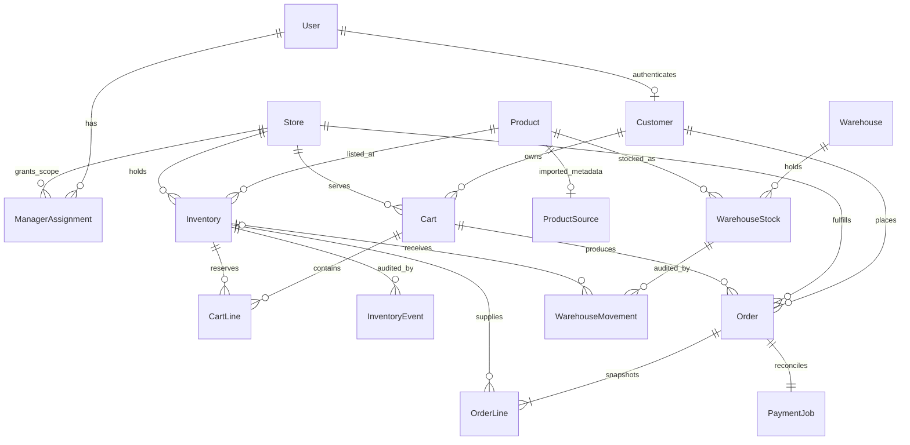

# Database schema

PostgreSQL is the shared transactional store. SQLite supports lightweight development and the independent operational log index.

## Customers and orders

`User` owns login credentials and staff flags. `Customer` is a purchasing identity with an optional one-to-one account. A guest has no synthetic User or password: a random customer key is stored in the browser's server-side session. Signed-in users resolve to their account's Customer. Guest orders are accessible only in the originating session; knowing an order UUID is insufficient.

Customer name/email fields are optional profile data reserved for later profile editing. Checkout contact details and buyer type live on Order as historical snapshots; they do not overwrite a profile. Losing a guest session currently loses self-service access. Guest recovery and merging carts at sign-in are not implemented.

Each customer has one Cart per Store. CartLine is unique per cart/inventory listing. Orders have a checkout idempotency key per customer. OrderLine snapshots quantity, product name, and integer-cent price while referencing the original listing. Historical names/prices are intentionally preserved rather than reading mutable current values.

## Products and inventory

Product holds shared identity and category. Inventory is unique per `(store, product)` and owns price, on-hand quantity, reserved quantity, active status, version, and ledger head. Available stock is derived as on hand minus reserved. All prices are CAD cents.

ProductSource is an optional one-to-one extension containing provider, unique barcode, import time, brand, package quantity, ingredients, allergen tags, and allowlisted nutrients. The source URL is derived from the barcode. Reimporting a barcode at another store reuses the product and metadata, while that store sets its own price and stock. Existing source data is not silently refreshed.

Allergen tags and nutrients use bounded JSON as descriptive provider attributes. They are not relational business keys in this application. If filtering or nutrition calculations became requirements, controlled tag/nutrient tables and explicit units would be appropriate. The schema does not claim fully normalized nutrition data. Missing values do not mean zero or allergen-free.

## Warehouse and payment records

WarehouseStock is unique per warehouse/product. WarehouseMovement records a receipt (positive delta, no destination) or completed transfer (negative delta, destination store listing). Source and destination share the same Product. This avoids copied product tables and ambiguous warehouse-or-store foreign keys. Goods in transit, batches, and partial deliveries are not modeled.

PaymentJob is one-to-one with Order and serves as a durable outbox. It stores provider, attempts, next attempt, lease token/deadline, provider session, and safe status code. Non-null provider sessions are unique. It stores no card details, credentials, or raw webhook bodies.

These migrations initialize the new web database; they do not import or alter the earlier C++ files.
